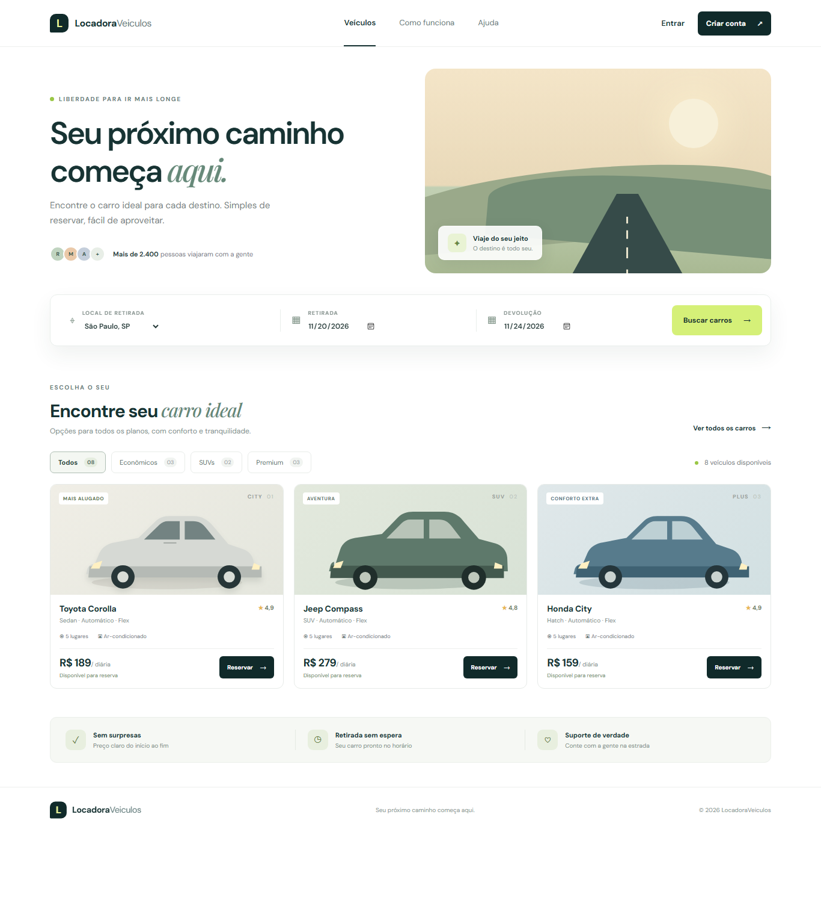
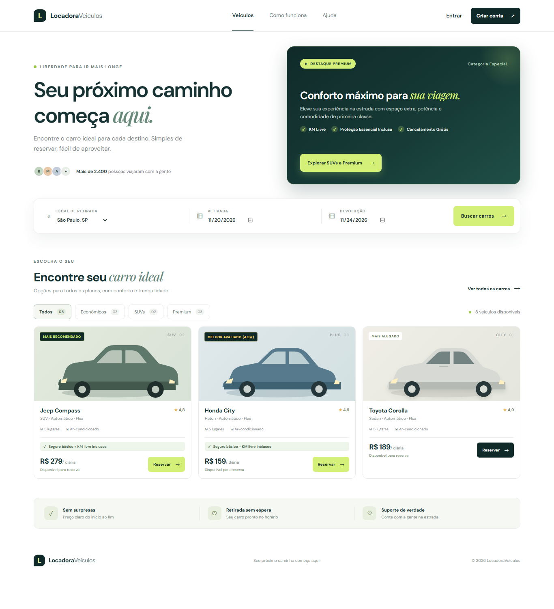

# Teste A/B — LocadoraVeiculos: Otimização de Veículos de Alta Margem

> **Disciplina:** _[preencher]_ | **Aluno(a):** _[preencher]_ | **Data de entrega:** 18/11/2026
> **Ferramenta:** PostHog (Feature Flags + Experiments) | **Feature flag:** `teste-ab-alta-margem`
> **Versão A (controle):** https://eduardotadeudealmeida.github.io/LocadoraVeiculos/

> ⚠️ Os números marcados com **[HIPOTÉTICO]** são estimativas para fins de exercício. Substitua por dados reais do PostHog quando houver.

---

## 1. Contexto e Problema

A LocadoraVeiculos é uma plataforma consolidada de locação de veículos. A análise de dados mostrou que os veículos de **maior margem de contribuição** (categorias **SUV** e **Premium**) vendem abaixo do potencial. Isso reduz o lucro por locação e a lucratividade geral.

**Objetivo:** usar Teste A/B para descobrir qual abordagem de interface aumenta cliques e reservas nos veículos de alta margem.

## 2. Identificação do Ponto de Alavancagem

### 2.1 Hipótese do problema (por que não vendem?)

| # | Causa provável | Evidência na versão atual (A) |
|---|---|---|
| 1 | **Baixa visibilidade:** o Toyota Corolla (econômico, "MAIS ALUGADO") ocupa a 1ª posição da vitrine. | Efeito de primazia: os primeiros cards recebem mais cliques. |
| 2 | **Hero sem valor comercial:** a metade superior direita da home mostra só uma ilustração de estrada ("Viaje do seu jeito"). | Nenhum CTA ou oferta no *above the fold*. |
| 3 | **Valor percebido fraco:** os selos "AVENTURA" e "CONFORTO EXTRA" são genéricos e não dão motivo concreto para pagar mais. | Sem prova social nem benefícios inclusos. |
| 4 | **Atrito/medo de custos ocultos:** o usuário não vê o que está incluso (seguro, km). | Preço maior sem justificativa. |

### 2.2 Hipótese formal

> **Se** destacarmos os veículos SUV e Premium com um banner no hero, posição prioritária na vitrine, selos de prova social e benefícios inclusos, **então** a taxa de cliques em "Reservar" nesses veículos vai aumentar, **porque** o usuário passa a vê-los primeiro e a perceber mais valor e menos risco.

- **H0:** não há diferença na taxa de cliques em "Reservar" de SUV/Premium entre A e B.
- **H1:** a taxa de cliques em "Reservar" de SUV/Premium é maior em B.

### 2.3 Local de aplicação

**Página inicial (`index.html`)**, em duas áreas:
1. **Hero (bloco superior direito):** onde está a ilustração da estrada.
2. **Vitrine de veículos:** aba "Todos".

**Por que aqui:** é a página de maior tráfego e onde o usuário decide qual carro explorar. Fica no topo do funil (home → reserva → checkout).

## 3. Versões do Teste

### 3.1 Versão A — Controle
Site atual, sem alterações:
- Hero com ilustração de estrada e selo "Viaje do seu jeito".
- Ordem da vitrine: Toyota Corolla (econômico) → Jeep Compass (SUV) → Honda City (Premium).
- Selos genéricos ("MAIS ALUGADO", "AVENTURA", "CONFORTO EXTRA").
- Botão "Reservar" escuro em todos os cards.

### 3.2 Versão B — Variante

| Elemento | Versão A (controle) | Versão B (variante) |
|---|---|---|
| **Hero (direita)** | Ilustração da estrada | **Card de oferta** com selo `DESTAQUE PREMIUM`, título "Conforto máximo para sua viagem", 3 benefícios (KM Livre • Proteção Essencial Inclusa • Cancelamento Grátis) e CTA "Explorar SUVs e Premium" (rola até a vitrine) |
| **Ordem da vitrine ("Todos")** | Econômico → SUV → Premium | **SUV → Premium → Econômico** |
| **Selos SUV/Premium** | "AVENTURA" / "CONFORTO EXTRA" | **"MAIS RECOMENDADO"** / **"MELHOR AVALIADO (4.9★)"** |
| **Linha de benefícios no card** | Não existe | "✓ Seguro básico + KM livre inclusos" |
| **Botão "Reservar" SUV/Premium** | Verde-escuro | **Verde-lima** (mesma cor do "Buscar carros") |

> Mudanças isoladas e mensuráveis. A identidade visual (creme, verde-escuro, verde-lima) é mantida.
> **Limitação:** B muda várias coisas ao mesmo tempo (teste "pacote"). Ele mede se o conjunto funciona, não qual alteração isolada contribuiu mais. Veja a seção 8 (próximos passos).

## 4. Métricas

| Tipo | Métrica | Evento PostHog | Definição |
|---|---|---|---|
| **Primária** | CTR de "Reservar" em SUV/Premium | `clicou_reservar_veiculo` com `categoria` ∈ {SUV, Premium} | usuários únicos que clicaram ÷ usuários únicos expostos |
| Secundária | Clique no hero | `clicou_hero_alta_margem` | só existe na variante B |
| Secundária | Mix de reservas | `clicou_reservar_veiculo` por `categoria` | % de cliques SUV+Premium sobre o total |
| Exposição | Visualização da variante | `visualizou_variante_ab` | denominador do teste |
| **Guardrail** | CTR geral de "Reservar" (todas as categorias) | `clicou_reservar_veiculo` | B não pode canibalizar as reservas totais |

Propriedades enviadas: `{ categoria: 'SUV' | 'Premium' | 'Economico', modelo, variante: 'control' | 'test' }`.

> **Limitação:** o funil medido vai até o clique em "Reservar". A conversão final (checkout concluído) exigiria instrumentar o `checkout.html`.

## 5. Configuração e Aplicação (PostHog)

### 5.1 Por que PostHog
Feature flags e experimentos na mesma ferramenta, SDK JavaScript simples (serve para HTML/CSS/JS puro), cálculo estatístico automático (bayesiano) e plano gratuito.

### 5.2 Passo a passo
1. Criar projeto no PostHog e copiar a **Project API Key**.
2. Colar o snippet no `<head>` do `index.html` e trocar `YOUR_POSTHOG_PROJECT_API_KEY` pela chave.
3. Criar o experimento em **Experiments → New experiment**:
   - Feature flag key: `teste-ab-alta-margem`
   - Variantes: `control` (50%) e `test` (50%)
   - Métrica primária: `clicou_reservar_veiculo` (filtro `categoria` = SUV ou Premium)
   - Métricas secundárias: `clicou_hero_alta_margem` e `clicou_reservar_veiculo` (geral, guardrail)
   - Definir o **tamanho mínimo de amostra** (seção 6.1) e a duração mínima.
4. Publicar o site (GitHub Pages) e lançar o experimento.
5. Validar com `?ab_variant=test` e `?ab_variant=control` (override de QA) e conferir os eventos em **Activity**.

### 5.3 Como o código funciona
- **Alocação:** o PostHog decide a variante pela feature flag e a mantém por usuário.
- **Aplicação:** o `script.js` adiciona a classe `variant-test` ao `<body>`. O CSS troca o hero, os selos e os botões, e o JS reordena os cards.
- **Anti-flicker:** `.hero-art`, `.hero-offer-card` e `.car-grid` ficam com `opacity:0` até a flag resolver.
- **Fallback:** se o PostHog demorar mais de 800 ms ou for bloqueado (AdBlock), a página mostra `control`, sem quebrar.
- **Atenção:** usuários que caem no fallback também disparam `visualizou_variante_ab` com `control`. Em produção, vale filtrar ou monitorar essa proporção para não enviesar o teste.

### 5.4 Arquivos alterados

| Arquivo | O que mudou |
|---|---|
| `index.html` | snippet PostHog, anti-flicker, card hero (B), `data-category`/`data-model`, selos e linhas de benefícios |
| `styles.css` | estilos do card, selos, linha de benefícios e regras `body.variant-test` |
| `script.js` (novo) | resolução da flag, fallback, reordenação, eventos e filtros |

## 6. Avaliação de Desempenho e Significância Estatística

### 6.1 Planejamento (antes de rodar)

| Parâmetro | Valor |
|---|---|
| Nível de significância (α) | 0,05 (bicaudal) |
| Poder estatístico (1−β) | 80% |
| CTR base (A) | 8% **[HIPOTÉTICO]** |
| Efeito mínimo detectável (MDE) | +3 p.p. (8% → 11%, ≈ +37% relativo) **[HIPOTÉTICO]** |
| **Amostra necessária** | ≈ **1.494 usuários por variante** (≈ 2.990 no total) |
| Duração mínima | 14 dias (cobrir 2 ciclos semanais) |

Cálculo aproximado para duas proporções:

$$n = \frac{(Z_{\alpha/2}+Z_{\beta})^2\,[p_1(1-p_1)+p_2(1-p_2)]}{(p_2-p_1)^2} = \frac{(1{,}96+0{,}84)^2\,[0{,}08\cdot0{,}92+0{,}11\cdot0{,}89]}{0{,}03^2} \approx 1.494$$

**Regras para evitar vícios:**
- Não encerrar o teste antes da amostra e da duração planejadas (evita o *peeking*).
- Divisão 50/50 e aleatória, com a mesma variante por usuário.
- Verificar a *Sample Ratio Mismatch* (SRM): a divisão real deve ser próxima de 50/50.
- Não alterar a página durante o teste.

### 6.2 Processo de análise
1. **Validar os dados:** exposições por variante, SRM, eventos disparando corretamente, ausência de tráfego de bots.
2. **Calcular a métrica primária:** CTR de Reservar em SUV/Premium para A e B.
3. **Testar a significância:**
   - **Teste z para duas proporções** (frequentista):
     $$z=\frac{\hat p_B-\hat p_A}{\sqrt{\hat p(1-\hat p)\left(\frac1{n_A}+\frac1{n_B}\right)}}$$
     Rejeita-se H0 se p-valor < 0,05.
   - **Intervalo de confiança de 95%** da diferença: o IC não pode incluir 0.
   - **PostHog:** usa abordagem bayesiana e mostra a *probabilidade de ser a melhor variante*. Critério de decisão: ≥ 95%.
4. **Avaliar a relevância prática:** o ganho precisa compensar financeiramente (impacto em receita/margem), não só ser estatisticamente significativo.
5. **Checar guardrails e secundárias:** o CTR geral não pode cair e o clique no hero deve ser coerente com o resultado.
6. **Segmentar** (opcional): mobile × desktop, novos × recorrentes.

### 6.3 Critério de decisão

| Resultado | Decisão |
|---|---|
| B significativamente melhor, guardrail estável | **Implantar B para 100%** |
| Sem diferença significativa | Manter A; rodar nova iteração isolando elementos |
| B pior ou guardrail prejudicado | **Descartar B** e revisar a hipótese |

### 6.4 Exemplo ilustrativo de resultado **[HIPOTÉTICO — substituir por dados reais]**

| | Usuários expostos | Cliques "Reservar" SUV/Premium | CTR |
|---|---|---|---|
| A — control | 1.520 | 122 | 8,03% |
| B — test | 1.510 | 181 | 11,99% |

- Diferença absoluta: +3,96 p.p. (≈ +49% relativo).
- z ≈ 3,63 → p-valor ≈ 0,0003 (< 0,05) → **estatisticamente significativo**.
- IC 95% da diferença ≈ [+1,8 ; +6,1] p.p.
- **Conclusão (exemplo):** B venceria. Seguiria para implantação com monitoramento.

## 7. Riscos e Limitações

- **Teste de pacote:** não isola qual mudança gerou o efeito.
- **Métrica de clique ≠ receita:** clicar em Reservar não garante locação concluída.
- **Efeito de novidade:** o banner pode atrair cliques só no início.
- **Tráfego baixo:** pode inviabilizar a amostra em prazo razoável. Nesse caso, aceitar um MDE maior ou rodar por mais tempo.
- **Selo "MELHOR AVALIADO (4.9★)":** deve refletir dados reais para evitar propaganda enganosa.
- **AdBlock:** parte dos usuários não é medida e cai no `control`.
- **Vitrine:** hoje tem só 3 cards; o contador dos filtros ("08 veículos") ainda mostra o valor original.

## 8. Próximos Passos

1. Rodar o teste e coletar a amostra planejada.
2. Instrumentar o `checkout.html` para medir a reserva concluída e a receita por visitante.
3. Se B vencer, desmembrar em testes isolados (hero × ordem × selos × cor do botão).
4. Considerar teste multivariado ou teste sequencial.

## 9. Referências

- PostHog — Experiments: https://posthog.com/docs/experiments
- PostHog — Feature Flags: https://posthog.com/docs/feature-flags
- Versão A (controle): https://eduardotadeudealmeida.github.io/LocadoraVeiculos/
- Repositório / código da variante B: `index.html`, `styles.css`, `script.js`

## 10. Anexos (a preencher)

### Print da Versão A (controle)

### Print da Versão B (variante)

> No Notion, as imagens não vêm no import do `.md`. Arraste os arquivos da pasta `prints/` para a página.

### Pendentes (dependem da sua conta do PostHog)
- [x] Print da Versão A
- [x] Print da Versão B
- [ ] Print da configuração do experimento no PostHog
- [ ] Print dos eventos em Activity
- [ ] Print dos resultados do experimento

